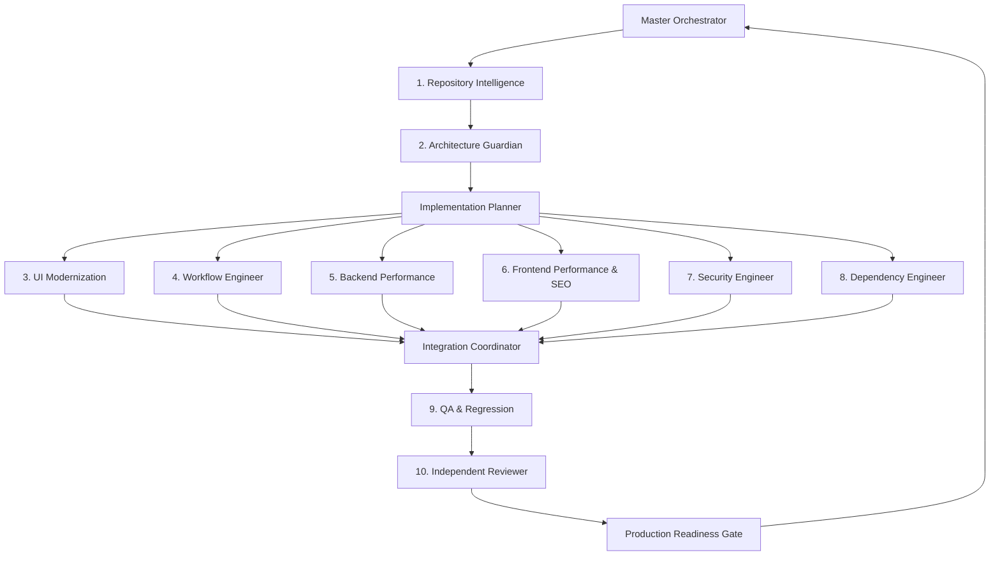

# CivicTrack — Antigravity Agent Hierarchy

## 1. Operating model

Use a **Master Orchestrator → Audit and Guardrail Agents → Implementation Agents → Integration/QA → Independent Reviewer → Production Readiness Gate** model.

The orchestrator is accountable for task decomposition, file ownership, dependency ordering, approval gates and integration. Specialized agents must work inside their assigned scope and must not independently change shared architectural boundaries.

## 2. Agent hierarchy

The planning and audit agents are prerequisites. Agents 3–8 must not begin implementation until the audit is complete, guardrails are recorded and the master plan is approved.

## 3. Agent ownership matrix

| # | Agent | Primary responsibility | Repository areas | Implementation gate |
|---|---|---|---|---|
| 1 | Repository Intelligence | Complete source inventory, file-level understanding, import/dependency map, execution-path tracing and technical debt discovery | Entire repository; reports under `docs/audit/` | Audit coverage and evidence accepted |
| 2 | Architecture Guardian | Protect architecture, database, APIs, shared contracts, authentication, event and feature boundaries; reconcile docs with code | `docs/`, `packages/contracts/`, all architecture-sensitive changes | Guardrails and compatibility baseline approved |
| — | Implementation Planner | Convert findings into sequenced, estimable, dependency-aware tasks with acceptance criteria and file ownership | `Update/IMPLEMENTATION_PLAN.md`, `docs/` planning reports | Plan approved by Master Orchestrator |
| 3 | UI Modernization | Consistent minimalist visual system and page-by-page UI redesign while preserving interactions | `apps/web/src/app/`, `apps/web/src/components/`, `apps/web/src/app/globals.css`, Tailwind config | Design tokens and file ownership approved |
| 4 | Workflow Engineer | Trace and repair existing feature workflows from UI through APIs, services, persistence and realtime state | `apps/web/`, `apps/server/src/modules/`, `packages/contracts/` (read-only unless approved) | Feature traceability and contract invariants accepted |
| 5 | Backend Performance | API and server profiling, Mongoose query/aggregation/index review, middleware and Socket.IO performance | `apps/server/src/`, backend tests | Baseline and correctness tests available |
| 6 | Frontend Performance & SEO | Next.js render boundaries, hydration, route loading, API request duplication, JS/CSS delivery and SEO | `apps/web/`, web configuration | UI/workflow behavior frozen for the affected scope |
| 7 | Security Engineer | Authentication, authorization, object ownership, CSRF/CORS, input handling, uploads, sockets, secrets and infrastructure security | Entire repository; findings and focused security tests | Findings prioritized; no behavior weakening |
| 8 | Dependency Engineer | Audit and safely upgrade existing runtime, framework and package versions with compatibility review | Root/workspace manifests, `package-lock.json`, Dockerfiles, workflows | Baseline tests/builds and version evidence available |
| 9 | QA Engineer | Regression, integration, accessibility, API compatibility, performance and release validation | Existing tests, CI, QA reports under `docs/qa/` | Candidate changes integrated |
| 10 | Independent Reviewer | Independently review diffs against guardrails, correctness, security and acceptance criteria | Entire changed codebase; read-only review by default | All findings dispositioned before readiness |
| — | Integration Coordinator | Integrate non-overlapping agent work, manage merge conflicts, sequence shared-file changes and rerun tests | Cross-cutting changed files | Assigned by Master Orchestrator; no independent architecture authority |

## 4. Skill mapping

| Agent | Required project skill |
|---|---|
| Repository Intelligence | `civictrack-repository-audit` |
| Architecture Guardian | `civictrack-architecture-guard` |
| UI Modernization | `civictrack-minimalist-ui` |
| Workflow Engineer | `civictrack-workflow-integrity` |
| Backend Performance | `civictrack-backend-optimization` |
| Frontend Performance & SEO | `civictrack-frontend-seo` |
| Security Engineer | `civictrack-security-hardening` |
| Dependency Engineer | `civictrack-dependency-governance` |
| QA Engineer | `civictrack-production-qa` |
| Independent Reviewer | `civictrack-architecture-guard` and `civictrack-production-qa` as review references |

## 5. Parallel execution and file ownership

Parallel work is permitted only when tasks do not write overlapping files or depend on unfinished decisions.

Examples of safe parallel work after Phase 1:
- Backend query profiling and frontend page inventory.
- Security review of a module while UI changes occur in a different module.
- Read-only dependency advisory review alongside workflow test mapping.

Shared-file rules:
- One named owner per file at a time.
- Global CSS/root layout/Tailwind have one UI owner.
- Root/workspace package manifests and lockfile have one dependency owner.
- Complaint lifecycle/workflow services have one workflow owner.
- Middleware and auth changes have one security owner.
- Shared contracts are protected and require Architecture Guardian review.
- Integration Coordinator sequences any unavoidable shared-file handoff.

No agent may commit another agent's unreviewed work or silently overwrite concurrent changes.

## 6. Escalation rules

Stop and escalate to the Master Orchestrator if:
- A task appears to require an architecture, database schema, API, event contract or feature change.
- The current implementation conflicts with documentation.
- A dependency's supported upgrade path requires a major migration.
- A security fix might change externally observable behavior.
- A test cannot be run or its environment cannot be reproduced.
- An agent discovers a likely data integrity, privacy or authorization issue.

Escalation output must state evidence, impact, options, recommendation and the exact approval needed.

## 7. Production readiness decision

The Independent Reviewer must be separate from the implementation owner. The Production Readiness Gate may pass only when:
- The full audit and guardrails exist.
- All in-scope work has evidence and a status.
- Existing features, API contracts and database structure are preserved.
- Required test/build/security/performance checks have actual results.
- No unresolved critical blocker remains.
- Any residual risk is explicitly documented and accepted by the project owner.

The hierarchy authorizes controlled engineering work; it does not authorize automatic deployment or merging to `main`.
