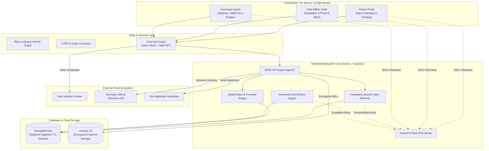
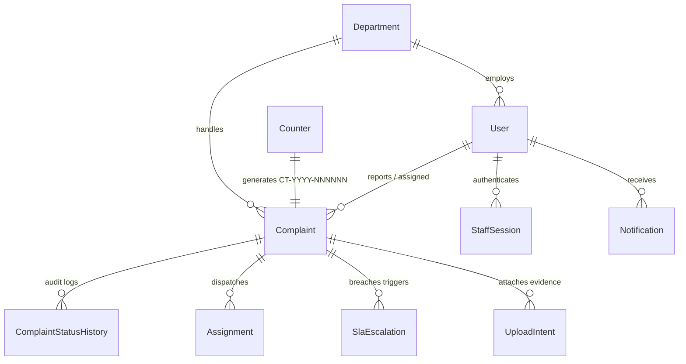

<div align="center">

# 🏛️ CivicTrack
### Smart Municipal Civic Complaint Management & Real-Time Resolution Platform

[](https://github.com/alokprasad573/CivicTrack/actions/workflows/ci.yml)
[](https://nodejs.org/)
[](https://www.typescriptlang.org/)
[-000000?logo=next.js&logoColor=white)](https://nextjs.org/)
[](https://expressjs.com/)
[](https://www.mongodb.com/)
[](https://socket.io/)
[](https://www.docker.com/)
[](https://maps.olacabs.com/)
[](https://opensource.org/licenses/MIT)

<p align="center">
  <b>A full-stack, enterprise-grade civic technology system engineered to eliminate municipal bottlenecks.</b><br/>
  Empowering citizens to report civic issues with spatial coordinates, providing field officers with turn-by-turn routing, and equipping municipal administrators with automated SLA tracking and real-time operational analytics.
</p>

[Architecture](docs/ARCHITECTURE.md) • [Database Structure & ERD](docs/DATABASE_STUCTURE.md) • [REST API Reference](docs/API_DOCUMENTATION.md) • [Features Guide](docs/FEATURES.md) • [Tech Stack & ADRs](docs/TECH_STACK.md) • [Quickstart Guide](docs/QUICKSTART.md)

</div>

---

## 💡 Executive Summary & The Problem

Municipal grievance management in most cities suffers from critical architectural failures:
1. **Opaque Resolution Timelines:** Citizens file complaints into a "black hole" with zero visibility into assignment, field progress, or status transitions.
2. **Bandwidth & Storage Chokepoints:** Heavy multimedia uploads (pothole images, electrical faults) congest API backends and exhaust server memory.
3. **Inefficient Field Operations:** Field officers lack turn-by-turn spatial navigation to incident sites and must rely on verbal directions.
4. **Unenforced SLAs:** Overdue complaints linger without automated managerial escalation, leading to public dissatisfaction.

**CivicTrack solves this end-to-end** by pairing a **Next.js 16 App Router** frontend with an **Express/MongoDB** real-time distributed backend. Built with a **monorepo architecture** and **shared Zod contracts**, it delivers instantaneous bidirectional WebSocket event streaming, direct-to-S3 pre-signed upload flows, automated SLA breach detection, and turn-by-turn map navigation.

---

## ⚡ Engineering Highlights (Why This Project Stands Out)

### 1. 📦 Microservices-Ready Monorepo Architecture
* Structured using **npm workspaces** with a dedicated `@civictrack/contracts` package.
* **Shared Zod Validation Schemas:** Client-side forms, REST route inputs, and WebSocket payloads share single-source-of-truth schemas, preventing runtime type drift and duplicate validation logic.
* Decoupled frontend (`apps/web`), backend API (`apps/server`), and configuration (`packages/config`).

### 2. 🔐 Dual-Identity Zero-Trust Security & Creator Data Isolation
* **Citizens:** Authenticated via **Clerk OAuth2** (Google, Email) with seamless session management and cryptographic webhook verification via **Svix**.
* **Municipal Staff (Officers & Admins):** Authenticated via a hardened **Custom JWT System** with SHA-256 hashed refresh tokens, device fingerprinting, and `HttpOnly`, `SameSite=Strict` cookies shielded against XSS and CSRF.
* **Creator-Based Admin Isolation:** Each administrator only accesses, monitors, and operates on departments they personally created (`createdByAdminId`). Cross-admin inspection, modification, or officer assignment is rejected with `403 Forbidden`.
* **Safe Field Officer Deletion:** Eliminates orphaned records by clearing active assignments (preserving historical complaint logs and transparency), revoking staff sessions, disconnecting WebSockets, and revoking pending invitations.
* **Role-Based Access Control (RBAC):** Strict tier isolation across `CITIZEN`, `OFFICER`, and `ADMIN` routes.

### 3. 🌐 Real-Time Bidirectional Event Streaming (Socket.IO)
* **Persist-Before-Emit Pattern:** Database state updates are committed atomically to MongoDB *before* WebSocket events are emitted, guaranteeing that clients never receive phantom notifications.
* **Scoped Room Taxonomy:** Targeted event routing across personal rooms (`user:{id}`), departmental channels (`department:{id}`), role broadcasts (`role:admin`), and issue threads (`complaint:{id}`).
* **Network Resilience:** Implements client-side **sliding-window event deduplication** and automated **stale-state reconciliation** on WebSocket reconnection.

### 4. 🗺️ Geospatial Intelligence & Field Navigation
* Stored as native **WGS 84 GeoJSON Points** (`[longitude, latitude]`) powered by MongoDB **`2dsphere` spatial indexes**.
* **Spatial Deduplication:** Automatically scans within a 50-meter radius to suppress duplicate submissions for the same civic category.
* **Turn-by-Turn Field Routing:** Integrated with the **Ola Maps Web SDK v2** and **Ola Directions API**, delivering live GPS route rendering for municipal response crews.

### 5. ☁️ Direct-to-Cloud Pre-Signed Upload Intent Pattern
* Eliminates server file handling by generating time-limited **Amazon S3 Pre-signed PUT URLs**.
* **Upload Intent Verification:** The API validates file size (<10MB) and MIME type (JPEG/PNG/WebP/PDF), marks the intent `PENDING`, and confirms successful direct upload before attaching it to a complaint record.

### 6. ⏱️ Automated SLA Monitoring & Escalation Engine
* Deterministic SLA resolution thresholds based on incident severity (`CRITICAL`: 12h, `HIGH`: 24h, `MEDIUM`: 48h, `LOW`: 72h).
* Background cron monitors overdue incidents every 15 minutes, auto-generates audit trail records, and triggers managerial alerts across administrative dashboards.

---

## 🏗️ High-Level System Architecture



> 📖 **Deep Dive:** For detailed component sequences and lifecycle diagrams, see [ARCHITECTURE.md](docs/ARCHITECTURE.md).

---

## 📊 Database Schema & ERD

CivicTrack uses **11 highly optimized collections** with compound indexes, TTL garbage collection, and spatial indices:



> 📖 **Deep Dive:** Full collection schemas, indexing strategies, and TTL specifications are documented in [DATABASE_STUCTURE.md](docs/DATABASE_STUCTURE.md).

---

## 🛠️ Technology Stack

| Layer | Technologies | Justification & Purpose |
| :--- | :--- | :--- |
| **Frontend Framework** | **Next.js 16 (App Router), React 19** | Server-side rendering (SSR), optimized bundle sizes, and granular layout caching. |
| **UI & Styling** | **Tailwind CSS, Lucide React** | Responsive, accessible, mobile-first design with dark/light theme tokens. |
| **Backend Runtime** | **Node.js 24 LTS, Express 4.21** | High-throughput, non-blocking asynchronous event loop with strict TypeScript safety. |
| **Shared Contracts** | **TypeScript 5.7, Zod 3.24** | End-to-end static and runtime validation across API boundaries. |
| **Database & ODM** | **MongoDB Atlas, Mongoose 8.10** | Document database with native GeoJSON `2dsphere` spatial indexing and atomic transitions. |
| **Real-time Engine** | **Socket.IO 4.8** | Low-latency bi-directional WebSocket communication with room-based multi-tenancy. |
| **Geospatial & Maps** | **Ola Maps Web SDK v2, MapLibre GL** | High-performance vector tile rendering, dynamic clustering, and turn-by-turn routing. |
| **Object Storage** | **Amazon Web Services (AWS) S3** | High-durability media storage leveraging time-limited pre-signed PUT/GET URLs. |
| **Identity & Security** | **Clerk, Custom JWT, bcryptjs, Svix** | Hybrid OAuth2 authentication for citizens and hardened JWT cookies for municipal staff. |
| **DevOps & CI/CD** | **Docker, GitHub Actions, GHCR** | Multi-stage image minimization, automated lint/typecheck gates, and container publishing. |

---

## 🚀 Key Capabilities

### 📱 Citizen Experience
* **Spatial Issue Reporting:** Report civic complaints with real-time GPS geolocation and landmark tagging.
* **Direct Evidence Capture:** Securely upload up to 5 photos directly to Amazon S3.
* **Live Status Timeline:** Track complaint progression through `SUBMITTED`, `REVIEWED`, `ASSIGNED`, `IN_PROGRESS`, `RESOLVED`, and `CLOSED`.
* **Proximity Map Discovery:** Explore nearby community complaints on an interactive vector map.
* **Citizen Feedback:** Rate municipal resolution quality with 1-5 star feedback and remarks.

### 👷 Municipal Field Officer Suite
* **Task Queue:** Filter assigned complaints by priority (`CRITICAL`, `HIGH`, `MEDIUM`, `LOW`) and SLA due date.
* **Turn-by-Turn Route Navigation:** One-tap navigation powered by Ola Maps Directions API guiding officers to incident coordinates.
* **Proof of Resolution:** Upload field photos directly from the incident site as cryptographic proof of completed work.

### 🏛️ Municipal Command Center (Admin)
* **Real-time Analytics Dashboard:** Live metrics on SLA compliance rate, daily trends, department breakdown, and overdue issues.
* **Automated & Manual Dispatch:** Assign complaints to relevant municipal departments (Roads, Electricity, Sanitation, Health) and specific officers.
* **Audit Trail & Governance:** Complete immutable historical log of every status transition, timestamp, and actor ID.
* **Staff Management:** Role-based staff registration, invitation tokens, and department assignment.

---

## 💻 Getting Started

### Prerequisites
* **Node.js**: `v24.0.0` or higher
* **npm**: `v10.0.0` or higher
* **MongoDB**: A running MongoDB instance or MongoDB Atlas cluster URI
* **AWS S3 Bucket**: For evidence storage (optional for local offline testing)
* **Clerk Account**: For citizen authentication (optional for local offline testing)

### 1. Clone & Install Dependencies
```bash
git clone https://github.com/alokprasad573/CivicTrack.git
cd CivicTrack
npm install
```

### 2. Configure Environment Variables
Copy the template configuration files:
```bash
# Server Environment
cp apps/server/.env.example apps/server/.env

# Web Client Environment
cp apps/web/.env.example apps/web/.env.local
```

Configure your credentials in `apps/server/.env`:
```env
PORT=4000
DATABASE_URL=mongodb+srv://<username>:<password>@cluster.mongodb.net/civictrack
STAFF_JWT_ACCESS_SECRET=your_32_character_minimum_access_secret_here!
STAFF_JWT_REFRESH_SECRET=your_32_character_minimum_refresh_secret_here!
AWS_REGION=ap-south-1
AWS_S3_BUCKET=civictrack-evidence-bucket
```

### 3. Build & Compile Contracts
Compile shared Zod contracts and types:
```bash
npm run build --workspace=@civictrack/contracts
```

### 4. Run Development Servers
Start both the API server and Next.js frontend concurrently:
```bash
# In Terminal 1 (Backend API & WebSocket Server):
npm run dev:server

# In Terminal 2 (Next.js Frontend Application):
npm run dev:web
```

* **Frontend Application:** `http://localhost:3000`
* **Backend REST API:** `http://localhost:4000/api/v1`
* **Interactive Swagger UI:** `http://localhost:4000/api/v1/docs`
* **API Health Check:** `http://localhost:4000/api/v1/health`

---

## 🧪 Testing & Quality Gates

CivicTrack maintains deterministic test coverage across security, real-time events, and domain logic:

```bash
# Run all monorepo typecheck gates
npm run typecheck

# Run linter across all workspaces
npm run lint

# Run full backend test suite (Auth, RBAC, SLA, S3, Maps, Socket.io, Security)
npm test --workspace=@civictrack/server
```

### Focused Test Suites
| Command | Test Focus |
| :--- | :--- |
| `npm run test:auth` | Citizen Clerk OAuth & Webhook cryptographic signature checks |
| `npm run test:staff-auth` | Municipal staff JWT authentication, refresh rotation & cookie security |
| `npm run test:admin-register` | Administrator registration real name validation & persistence |
| `npm run test:admin-scoped-data` | Multi-tenant creator data isolation, cross-admin rejection & empty state protection |
| `npm run test:officers` | Safe field officer deletion, referential integrity & department code filtering |
| `npm run test:complaints` | Complaint lifecycle state machine, transitions & reference number generation |
| `npm run test:socket` | Socket.IO room isolation, dual-handshake auth, and deduplication |
| `npm run test:maps` | Ola Maps geocoding, directions API, and spatial bounding boxes |
| `npm run test:security` | CSRF origin protection, regex sanitization, rate limiting, and stack suppression |

---

## 🐳 Docker & Production Deployment

CivicTrack includes multi-stage Dockerfiles optimized for lightweight production container images:

```bash
# Build and run the entire stack locally with Docker Compose
docker-compose up --build
```

### Continuous Integration & Deployment (CI/CD)
* **GitHub Actions CI (`ci.yml`):** Runs on every push and pull request. Enforces static analysis, workspace typechecks, deterministic backend test suites, and Next.js build verification.
* **GitHub Actions CD (`cd.yml`):** Automatically packages production container images, publishes them to **GitHub Container Registry (GHCR)** (`ghcr.io/alokprasad573/civictrack/server` & `web`), triggers cloud webhooks, and executes automated post-deploy live health checks.

---

## 📄 License & Attribution

This project is open-sourced under the **MIT License** — see the [LICENSE](LICENSE) file for details.

Developed with ❤️ by **Alok Prasad** for modern, transparent, and resilient municipal governance.
