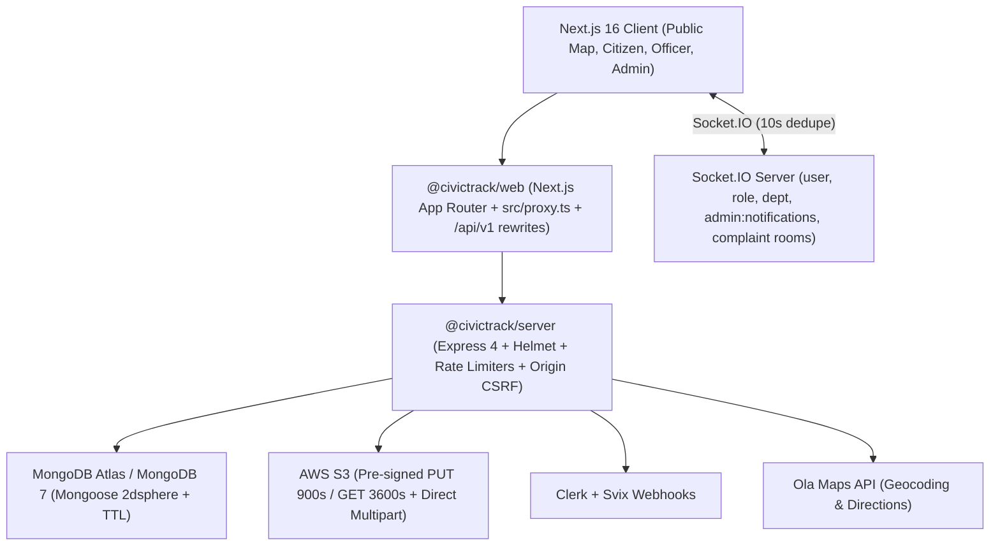
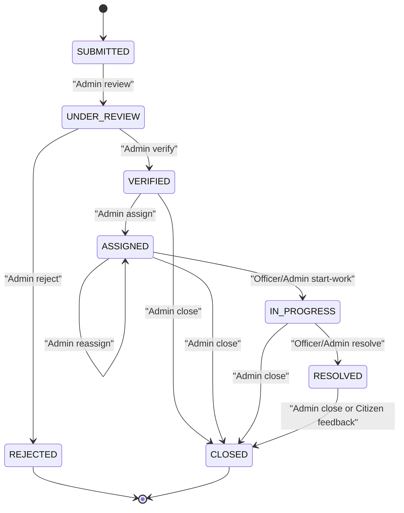

# CivicTrack — Smart Civic Complaint Management Platform

> **Real-time municipal issue reporting, triage, field resolution, and SLA monitoring** built as an npm Workspaces TypeScript monorepo.

[](package.json)
[](tsconfig.base.json)
[](package.json)
[](apps/web/package.json)
[](apps/web/package.json)
[](apps/web/tailwind.config.ts)
[](apps/server/package.json)
[](apps/server/package.json)
[](docs/API_DOCUMENTATION.md)
[](packages/contracts/package.json)
[](docs/ARCHITECTURE.md)
[](docs/ARCHITECTURE.md)
[](docs/TECH_STACK.md)
[](docs/API_DOCUMENTATION.md)
[](docker-compose.yml)
[](.github/workflows/ci.yml)
[](LICENSE)

[Architecture](docs/ARCHITECTURE.md) • [Database Structure & ERD](docs/DATABASE_STRUCTURE.md) • [REST API Reference](docs/API_DOCUMENTATION.md) • [Features Guide](docs/FEATURES.md) • [Tech Stack & ADRs](docs/TECH_STACK.md) • [Quickstart Guide](docs/QUICKSTART.md) • [CI/CD Pipeline](docs/CI_CD_PIPELINE.md)

---

## Overview

CivicTrack connects citizens, municipal administrators, and field officers across three role-specific portals backed by a modular Express + Socket.IO API and shared Zod contracts (`@civictrack/contracts`):

- **Public Spatial Explorer (`/map`)**: Interactive Ola Maps + MapLibre GL explorer (`2 km`–`100 km` radius, category/status filters, Show/Hide Closed toggle, distance sorting) consuming sanitized public allowlist DTOs (`GET /api/v1/complaints/nearby`).
- **Citizen Portal (`/citizen/*`)**: Clerk-authenticated 4-step issue reporting wizard with Ola Maps pin selection and up to 5 JPEG/PNG/WebP images (`<=10MB`), live `ComplaintStatusTracker`, zoomable `EvidenceLightbox`, in-app notifications, and 1–5 star feedback (closing `RESOLVED` complaints).
- **Field Officer Portal (`/officer/*`)**: Invite-only onboarding, dual **Assigned Directly to Me** / **Department Queue** views, resolution upload via S3 pre-signed PUT intents with multipart fallback, nearby duplicate inspection, and turn-by-turn **OfficerNavigation** HUD with optional Web Speech voice guidance.
- **Admin Portal (`/admin/*`)**: Creator-isolated department and officer management, staff invitation lifecycle (`PENDING`/`ACCEPTED`/`REVOKED`), complaint review/verification/rejection/assignment/closure workflow, `250m` duplicate candidate scoring and non-destructive linking, analytics dashboard, and manual + 15-minute scheduled SLA breach scans.

---

## System Architecture



### Complaint Lifecycle



> Full workflow details, room topology, and sequence diagrams live in [docs/ARCHITECTURE.md](docs/ARCHITECTURE.md). Full schemas and indexes live in [docs/DATABASE_STRUCTURE.md](docs/DATABASE_STRUCTURE.md).

---

## Workspace Structure & Stack

| Workspace | Package | Stack & Purpose |
| :--- | :--- | :--- |
| `apps/web` | `@civictrack/web` | Next.js `^16.4.6`, React `^19.0.0`, Tailwind CSS `^3.4.17` (light mode), `@clerk/nextjs ^7.10.7`, `olamaps-web-sdk ^1.4.0`, `maplibre-gl ^5.12.0`, `socket.io-client ^4.8.4`, `lucide-react ^0.475.0` |
| `apps/server` | `@civictrack/server` | Express `^4.21.2`, Mongoose `^8.10.1`, Socket.IO `^4.8.4`, `@clerk/express ^2.1.96`, `jsonwebtoken ^9.0.3`, `bcryptjs ^3.0.3`, `svix ^2.11.0`, `@aws-sdk/* ^3.1175.0`, `multer ^2.5.0`, `helmet ^8.0.0`, `express-rate-limit ^8.7.5`, `swagger-ui-express ^5.0.1` |
| `packages/contracts` | `@civictrack/contracts` | Shared Zod `^3.24.2` schemas, enums, DTOs, and Socket.IO event contracts |
| `packages/config` | `@civictrack/config` | Workspace stub (`exit 0` scripts); shared strict TypeScript config resides in [`tsconfig.base.json`](tsconfig.base.json) |

---

## Getting Started

1. **Check Node.js (`>=24.0.0`), install dependencies, and build contracts:**
   ```bash
   npm install
   npm run build --workspace=@civictrack/contracts
   ```
2. **Configure environment files** from [`apps/server/.env.example`](apps/server/.env.example) (`apps/server/.env`) and [`apps/web/.env.example`](apps/web/.env.example) (`apps/web/.env.local`):
   - Server uses `ATLAS_URI`, `STAFF_JWT_ACCESS_SECRET` / `STAFF_JWT_REFRESH_SECRET` (`STAFF_JWT_ACCESS_EXPIRY` default `15m`, `STAFF_JWT_REFRESH_EXPIRY` default `7d`), `AWS_S3_BUCKET_NAME`, Clerk keys, and Ola Maps credentials.
   - Web sets `NEXT_PUBLIC_API_URL` (default `http://localhost:4000/api/v1`; Socket.IO derives its host by stripping `/api/v1`) and `INTERNAL_API_URL` (set `http://localhost:4000` when running `apps/server` locally on port `4000`).
3. **Sync indexes & seed sample staff/departments (`TRANS`, `SWM`):**
   ```bash
   npm run sync:indexes --workspace=@civictrack/server
   npm run seed:staff --workspace=@civictrack/server
   ```
4. **Start development servers:**
   ```bash
   npm run dev:server   # Express + Socket.IO on http://localhost:4000
   npm run dev:web      # Next.js App Router on http://localhost:3000
   ```
   Useful server URLs: `http://localhost:4000/health`, `http://localhost:4000/ready`, `http://localhost:4000/docs`, `http://localhost:4000/api/v1`.

> Step-by-step configuration, Docker Compose (`docker compose up --build`), and seeding overrides are covered in [docs/QUICKSTART.md](docs/QUICKSTART.md).

---

## Scripts & Testing

| Command | Scope & Behavior |
| :--- | :--- |
| `npm run build` | Builds workspace packages |
| `npm run typecheck` | Typechecks workspaces (requires built `@civictrack/contracts`) |
| `npm run lint` | Runs workspace lint scripts (`@civictrack/web` runs `tsc --noEmit`; `@civictrack/config` exits `0`) |
| `npm test` | Runs all workspace test scripts (`15` deterministic server suites; contracts/web report placeholder exit `0`) |
| `npm run test --workspace=@civictrack/server` | Runs the 15 deterministic backend test suites (`tsx`) |
| `npm run test:integration:db --workspace=@civictrack/server` | MongoDB integration tests (`REQUIRE_TEST_DB=true`) |
| `npm run test:storage:integration --workspace=@civictrack/server` | S3 integration tests (`CIVICTRACK_S3_INTEGRATION_TESTS=true`) |
| `node scripts/test-endpoints.mjs` | Smoke-tests a running server on `127.0.0.1:4000` |

---

## CI/CD & Containers

- **CI ([`.github/workflows/ci.yml`](.github/workflows/ci.yml)):** Runs `quality-gate` (build contracts, typecheck, lint, `npm test` across 15 backend suites) and `build-gate` (production builds with CI API env defaults).
- **CD ([`.github/workflows/cd.yml`](.github/workflows/cd.yml)):** Publishes `server` and `web` Docker images to GHCR (`ghcr.io/<repo>/server`, `ghcr.io/<repo>/web`) and reads `PRODUCTION_API_URL` from `vars` or `secrets`.
- **Docker Compose ([`docker-compose.yml`](docker-compose.yml)):** Orchestrates `mongodb` (`mongo:7-jammy`), `server`, and `web`.

See [docs/CI_CD_PIPELINE.md](docs/CI_CD_PIPELINE.md) for details.

---

## License

The repository [`LICENSE`](LICENSE) file grants the **MIT License** (`Copyright (c) 2026 Alok Prasad`); note that root [`package.json`](package.json) metadata declares `"license": "ISC"`.
