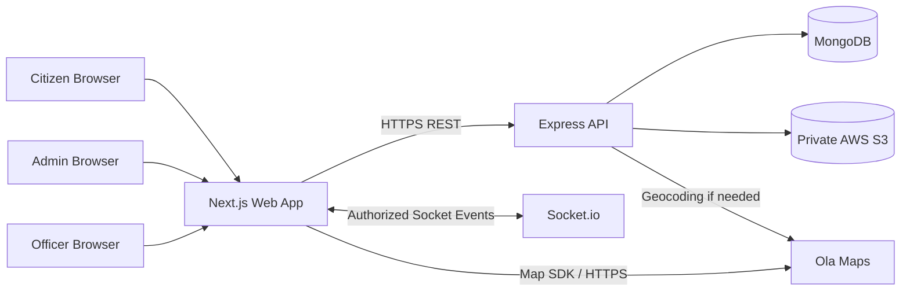

# CivicTrack — System Architecture & Engineering Design

**Version:** 1.0  
**Architecture style:** Modular monolith, REST API, event-driven real-time delivery

## 1. Architecture overview

Use a monorepo with two deployable applications:
- `apps/web`: Next.js frontend
- `apps/server`: Express.js backend

Shared contracts may live in `packages/contracts` and shared lint/TypeScript configuration in `packages/config`. Do not share server-only code with the browser bundle.

The backend is a modular monolith. Each domain module owns its routes, controller, service, repository/model, validation schemas, and tests. Modules communicate through service interfaces or explicit internal events, not by importing another module's private implementation.

## 2. System context



Ola Maps SDK/API usage must follow the provider's current documentation, product terms, API key restrictions, and supported endpoints. Do not invent endpoint paths or SDK methods. Isolate Ola Maps calls behind a small adapter so provider changes do not leak across the application.

## 3. Runtime request flows

### Complaint creation
1. Browser requests an upload intent from Express.
2. Express authenticates the citizen, validates declared file metadata, and creates a short-lived S3 pre-signed PUT URL for a generated object key.
3. Browser uploads file bytes directly to S3.
4. Browser submits complaint details plus uploaded object keys.
5. Express verifies ownership/expected key prefix and object existence/metadata where practical.
6. Complaint service validates coordinates/category and creates the complaint.
7. Status history and notification records are created.
8. Socket.io emits an authorized update to the citizen/admin audience.

Use a cleanup job for orphaned uploads that were never attached to a complaint.

### Assignment
1. Admin submits department/officer assignment.
2. API checks admin permission and validates the complaint's current state.
3. Service performs conditional/atomic assignment so stale concurrent requests fail cleanly.
4. Assignment history and audit event are written.
5. Notification is persisted and emitted.

### Status update
1. Officer submits the requested transition and remarks.
2. Service verifies officer is assigned to the complaint.
3. Domain transition rules validate current and target states.
4. Persist status and history consistently.
5. Notify the citizen and relevant admins.

## 4. Backend module boundaries

Suggested modules:
- `identity`: Clerk session verification, webhook synchronization, local user provisioning and application authorization
- `users`: profiles and user administration
- `departments`: departments and officers
- `complaints`: creation, listing, details, evidence references
- `assignments`: assignment and reassignment
- `workflow`: status transitions and history
- `storage`: S3 pre-signed upload/download URLs
- `maps`: Ola Maps adapter and geocoding abstraction
- `notifications`: persisted in-app notifications and Socket.io delivery
- `duplicate-detection`: candidate generation and similarity scoring
- `analytics`: aggregation endpoints
- `sla`: due-date calculation, overdue scans, escalation
- `audit`: append-only business audit records

A module should not own unrelated business rules. Controllers should remain thin; business rules belong in services/domain logic.

## 5. Suggested backend structure

```text
apps/server/src/
  app.ts
  server.ts
  config/
    env.ts
    database.ts
    logger.ts
    cors.ts
  common/
    errors/
    middleware/
    types/
    utils/
  modules/
    identity/
      identity.routes.ts
      clerk.middleware.ts
      clerk-webhook.controller.ts
      identity.service.ts
      identity.schema.ts
      identity.test.ts
    complaints/
      complaint.routes.ts
      complaint.controller.ts
      complaint.service.ts
      complaint.repository.ts
      complaint.schema.ts
      complaint.model.ts
    departments/
    assignments/
    workflow/
    storage/
    maps/
    notifications/
    duplicate-detection/
    analytics/
    sla/
    audit/
  jobs/
  sockets/
  tests/
```

## 6. Suggested frontend structure

```text
apps/web/src/
  app/
    (public)/
    (auth)/
    citizen/
    admin/
    officer/
  components/
    ui/
    shell/
    feedback/
    maps/
    charts/
  features/
    auth/
    complaints/
    assignments/
    departments/
    notifications/
    analytics/
  lib/
    api-client.ts
    env.ts
    permissions.ts
  hooks/
  types/
```

Use Next.js App Router. Keep server components as the default where suitable; use client components for interactive forms, maps, charts, and real-time behavior. Do not expose secret keys through `NEXT_PUBLIC_` variables.

## 7. Data model outline

### User
- `_id`
- `clerkUserId` (unique, indexed)
- `email` (unique, normalized)
- `name`
- `role`: `CITIZEN | ADMIN | OFFICER`
- `departmentId` (required for officers)
- `isActive`
- `createdAt`, `updatedAt`

### Department
- `_id`
- `name`
- `code` (unique)
- `categories[]`
- `isActive`

### Complaint
- `_id`
- `referenceNumber` (unique)
- `citizenId`
- `title`
- `description`
- `category`
- `status`
- `priority`
- `location`: GeoJSON Point `{ type, coordinates: [lng, lat] }`
- `address`
- `landmark`
- `evidence[]`: `{ objectKey, contentType, size, uploadedAt }`
- `departmentId`
- `assignedOfficerId`
- `dueAt`
- `resolvedAt`
- `closedAt`
- `createdAt`, `updatedAt`

### Assignment
- `_id`
- `complaintId`
- `departmentId`
- `officerId`
- `assignedBy`
- `remarks`
- `assignedAt`
- `unassignedAt`

### ComplaintStatusHistory
- `_id`
- `complaintId`
- `fromStatus`
- `toStatus`
- `actorId`
- `remarks`
- `evidence[]`
- `createdAt`

### Notification
- `_id`
- `recipientId`
- `type`
- `title`
- `message`
- `resourceType`
- `resourceId`
- `readAt`
- `createdAt`

### AuditLog
- `_id`
- `actorId`
- `action`
- `resourceType`
- `resourceId`
- `metadata` (allowlisted fields only)
- `requestId`
- `createdAt`

Use references for high-cardinality relations. Avoid embedding unbounded histories in complaint documents.

## 8. Index strategy

At minimum:
- `users.clerkUserId`: unique
- `users.email`: unique
- `complaints.referenceNumber`: unique
- `complaints.citizenId + createdAt`
- `complaints.status + createdAt`
- `complaints.departmentId + status + priority`
- `complaints.location`: `2dsphere`
- `assignments.complaintId + assignedAt`
- `notifications.recipientId + readAt + createdAt`
- `complaintStatusHistory.complaintId + createdAt`

Review indexes against actual query plans; indexes improve reads but add write/storage overhead.

## 9. API conventions

Base path: `/api/v1`

Use consistent JSON envelopes:
```json
{
  "success": true,
  "data": {},
  "meta": {}
}
```

Error envelope:
```json
{
  "success": false,
  "error": {
    "code": "VALIDATION_ERROR",
    "message": "Please check the submitted fields.",
    "details": []
  },
  "requestId": "..."
}
```

Representative endpoints:
- `GET /users/me` (returns local CivicTrack profile for authenticated Clerk identity)
- `POST /webhooks/clerk` (public endpoint; verifies Clerk webhook signature before processing)
- `POST /storage/upload-intents`
- `POST /complaints`
- `GET /complaints`
- `GET /complaints/:id`
- `GET /complaints/:id/history`
- `POST /complaints/:id/verify`
- `POST /complaints/:id/reject`
- `POST /complaints/:id/assign`
- `POST /complaints/:id/status`
- `POST /complaints/:id/feedback`
- `GET /departments`
- `GET /officer/complaints`
- `GET /analytics/overview`
- `GET /analytics/trends`
- `GET /analytics/departments`
- `GET /analytics/geo-density`
- `GET /notifications`
- `PATCH /notifications/:id/read`

Use pagination (`page`/`limit` or cursor pagination), allowlisted sort fields, and validated filters. Do not return internal S3 keys to unauthorized clients.

## 10. Real-time event design

Suggested events:
- `complaint:created`
- `complaint:status-updated`
- `complaint:assigned`
- `notification:new`

Authenticate Socket.io handshake using a Clerk session token verified server-side. Resolve the local CivicTrack user and rooms from authenticated server-side identity. Example rooms: `user:{userId}`, `role:admin`, `department:{departmentId}`. Never allow arbitrary room joins from client input.

Persist first, emit second. If an event emit fails, the notification record remains available for later fetch.

## 11. Duplicate detection design

Initial deterministic candidate scoring:
- Same category: required candidate filter
- Nearby distance: configurable radius, e.g. 100–250 metres depending on category
- Text similarity: normalized token/Jaccard or a vetted similarity library
- Exclude closed/rejected complaints by default, configurable by category

Return a score and reasons, such as:
- `SAME_CATEGORY`
- `WITHIN_DISTANCE`
- `DESCRIPTION_SIMILARITY`

This is a review aid, not an automated decision.

## 12. Security controls

- Helmet and strict CORS allowlist.
- Rate limiting on auth, upload-intent, and complaint creation routes.
- Zod validation for params, query, and body.
- Server-side RBAC and object-level authorization.
- Verify Clerk session tokens using the official Clerk SDK; never merely decode tokens.
- Set explicit `authorizedParties` / allowed origins where supported; configure strict CORS and CSRF protections for the chosen request model.
- Keep Clerk secret and webhook signing secret server-side. Do not implement local password hashing or custom refresh-token rotation.
- S3 least-privilege IAM and private bucket.
- Short expiry for signed URLs.
- File count/size/type validation and malware scanning strategy before production.
- Structured logs with redaction.
- Secrets only in environment/secret manager.
- No production secrets in source control or client bundles.

## 13. Deployment topology

- Next.js: Vercel
- Express API: Render
- MongoDB: managed MongoDB deployment
- Evidence: private AWS S3 bucket
- Maps: Ola Maps client SDK/API as documented
- Socket.io: same Express service initially, with WebSocket support enabled on host

Confirm hosting plan support for WebSockets, persistent connections, environment variables, and health checks before deployment. Configure production CORS and cookie domain/SameSite settings carefully.

## 14. Observability and operations

- `GET /health` for liveness
- `GET /ready` for dependency readiness
- Request correlation ID
- Structured JSON logs
- Error monitoring integration can be added later
- Metrics: request latency, error rate, socket connection count, upload failures, overdue complaints
- Scheduled jobs must be idempotent and protected against overlapping execution


## 15. Clerk authentication and authorization architecture

Clerk is the identity provider; CivicTrack's API remains the authorization authority.

### Request flow
1. User signs in through Clerk UI in Next.js.
2. Next.js obtains the Clerk session state through the official Clerk SDK.
3. Browser sends the Clerk session token to the Express API using the supported cookie or `Authorization: Bearer` pattern for the deployed topology.
4. Express verifies the token cryptographically through the official Clerk SDK.
5. API maps the verified Clerk `userId` (`sub`) to `users.clerkUserId`.
6. API checks local `isActive`, role, department membership, and resource ownership/assignment before executing the request.

### Local user model
```ts
type AppRole = "CITIZEN" | "ADMIN" | "OFFICER";

interface User {
  clerkUserId: string; // unique, indexed; Clerk identity identifier
  email: string;
  name: string;
  role: AppRole;
  departmentId?: Types.ObjectId;
  isActive: boolean;
  createdAt: Date;
  updatedAt: Date;
}
```

Do not use Clerk public metadata as the sole source of application privileges. Never accept a role or department from a public registration payload. Provision Admin and Officer accounts through protected administrative workflows.

### Clerk webhooks
- Verify webhook signatures using `CLERK_WEBHOOK_SIGNING_SECRET` (Clerk's signing secret).
- Subscribe only to events needed for identity synchronization, such as user create/update/delete.
- Make event handling idempotent using the webhook event ID; handle retries safely.
- Return success only after the event is durably processed or safely queued.
- The webhook endpoint is intentionally unauthenticated by user session; signature verification is mandatory.

## 16. Environment variable ownership

Use `apps/server/.env` for server-only credentials and `apps/web/.env.local` for Next.js configuration. See `06_ENVIRONMENT_SETUP.md` for the full templates and variable-by-variable rules.

Never prefix AWS credentials, `ATLAS_URI`, `CLERK_SECRET_KEY`, `CLERK_WEBHOOK_SIGNING_SECRET`, `OLA_MAP_CLIENT_SECRET`, or server-only API keys with `NEXT_PUBLIC_`.
