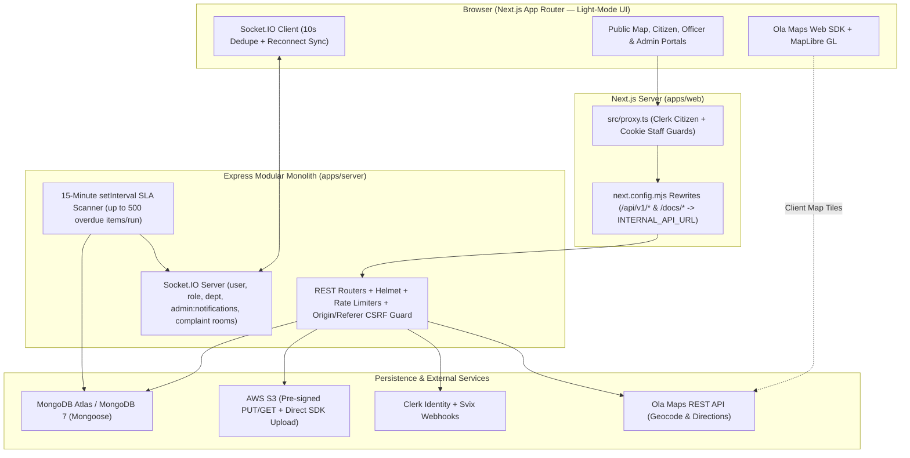
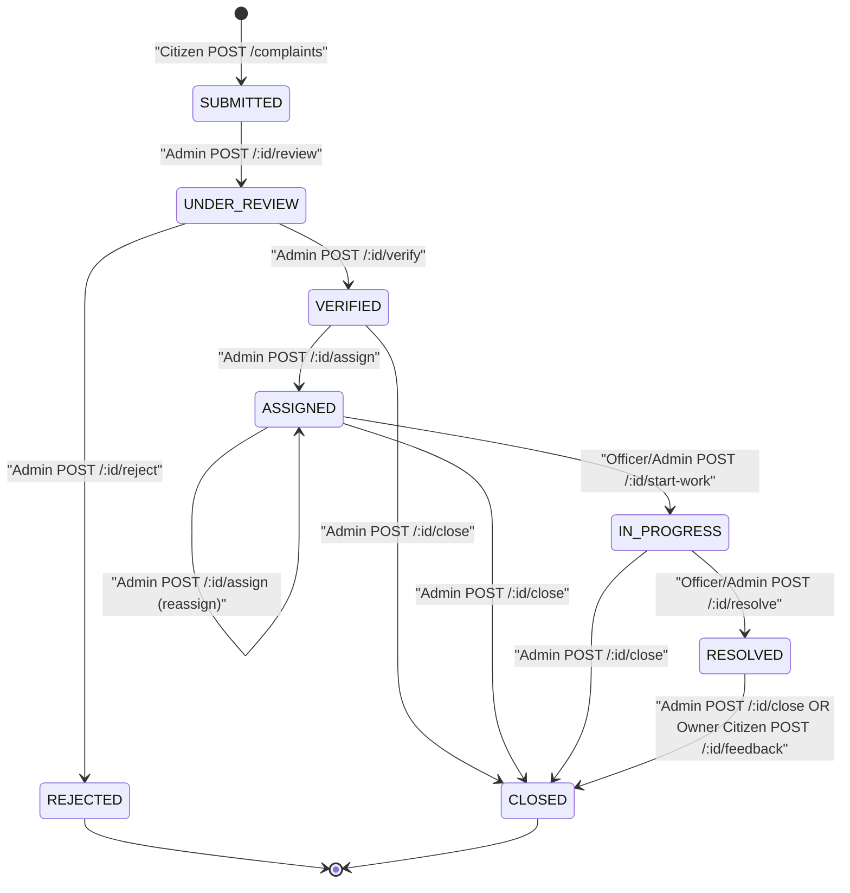
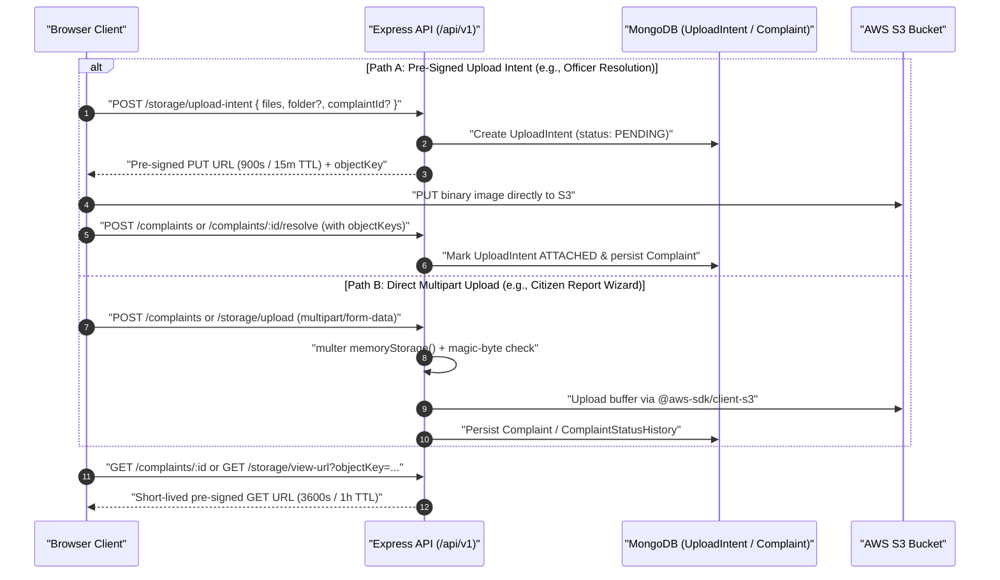

# CivicTrack — System Architecture

> Comprehensive technical architecture grounded in the implemented monorepo under [`apps/web/`](../apps/web), [`apps/server/`](../apps/server), and [`packages/`](../packages).

**Related Docs:** [README](../README.md) • [Database Structure](DATABASE_STRUCTURE.md) • [API Documentation](API_DOCUMENTATION.md) • [Features](FEATURES.md) • [Tech Stack](TECH_STACK.md) • [Quickstart](QUICKSTART.md) • [CI/CD Pipeline](CI_CD_PIPELINE.md)

---

## 1. Monorepo Architecture

CivicTrack is organized as an **npm Workspaces** monorepo (`"workspaces": ["packages/*", "apps/*"]`, Node.js `>=24.0.0`):

```text
CivicTrack/
├── apps/
│   ├── web/              # Next.js 16 App Router frontend (@civictrack/web)
│   └── server/           # Express 4 + Socket.IO + Mongoose API (@civictrack/server)
├── packages/
│   ├── contracts/        # Shared Zod schemas, enums & DTO types (@civictrack/contracts)
│   └── config/           # Minimal workspace package stub (tsconfig.base.json lives at repo root)
├── scripts/
│   └── test-endpoints.mjs # Live HTTP smoke check script targeting 127.0.0.1:4000
├── tsconfig.base.json    # Shared strict TypeScript configuration extended across workspaces
└── docker-compose.yml    # Local multi-container setup (mongo:7-jammy, server:4000, web:3000)
```

> **Build Dependency:** `@civictrack/contracts` compiles TypeScript to `dist/` and must be built (`npm run build --workspace=@civictrack/contracts`) before typechecking, testing, or building `apps/server` and `apps/web`. `@civictrack/config` currently contains only `package.json` (`exit 0` no-op scripts); there is no ESLint or Prettier setup in the repository.

---

## 2. System & Network Topology



> **Routing Note:** In production/container setups, Next.js (`apps/web/next.config.mjs`) proxies `/api/v1/:path*` and `/docs/:path*` directly to `INTERNAL_API_URL` and applies CSP, `X-Frame-Options: DENY`, and `Permissions-Policy` headers without a separate Nginx service or PWA service worker.

---

## 3. Dual Authentication & Security Boundaries

### 3.1 Identity Separation

| Persona | Auth Mechanism | Session Storage / Transport | Verification Layer |
| :--- | :--- | :--- | :--- |
| **Citizen** | Clerk (`@clerk/nextjs` + `@clerk/express`) | Clerk session + JIT/webhook user provisioning (`POST /api/v1/webhooks/clerk` via Svix) | `src/proxy.ts` + `clerk.middleware.ts` |
| **Admin** | Custom staff email/password (`ADMIN`) | `civictrack_admin_token` (15m default) & `civictrack_admin_refresh` (7d default) HTTP-only cookies | `src/proxy.ts` + `rbac.middleware.ts` |
| **Officer** | Invite-only onboarding (`OFFICER`) | `civictrack_officer_token` & `civictrack_officer_refresh` HTTP-only cookies | `src/proxy.ts` + `rbac.middleware.ts` |

- **Cookie Flags (`staff-auth.controller.ts`):** `httpOnly: true`, `secure: NODE_ENV === "production"`, `sameSite: "lax"`, `path: "/"`.
- **CSRF Guard (`app.ts`):** Mutating HTTP requests bearing staff cookies (excluding webhooks) validate `Origin` or `Referer` against the configured allowed origins and return `403` (`CSRF_DETECTED`) on mismatch.
- **Creator-Based Admin Isolation:** Administrators manage departments (`Department.createdByAdminId`), department officers, invitations, analytics, and complaints scoped to their created departments and unassigned items in their operational boundary. Officers are scoped to their assigned `departmentId`.

---

## 4. Complaint Lifecycle State Machine

Transitions are enforced server-side in `ComplaintWorkflowService` (`apps/server/src/modules/complaints/complaint-workflow.service.ts`) and `ComplaintSubmissionService` (`complaint-submission.service.ts`). Every persisted status change appends a `ComplaintStatusHistory` audit entry **before** dispatching Socket.IO events and persisted `Notification` records.



- **Feedback Behavior:** Submitting citizen feedback (`POST /api/v1/complaints/:id/feedback`) is permitted on `RESOLVED` or `CLOSED` complaints; on `RESOLVED`, it automatically transitions the complaint to `CLOSED`. There is no citizen rejection or reopen path back to `IN_PROGRESS`.

---

## 5. Evidence Storage & Upload Flows

CivicTrack validates uploads strictly by **magic bytes** for **JPEG (`image/jpeg`), PNG (`image/png`), and WebP (`image/webp`)** only (max **10 MB per file**, max **5 files**). Both client-to-S3 pre-signed intents and direct backend multipart uploads are implemented:



---

## 6. Spatial Duplicate Detection, SLA & Realtime Architecture

### 6.1 Duplicate Detection (`duplicate-detection.service.ts`)
- Duplicate detection is a **staff inspection and advisory linking** workflow (`GET /api/v1/duplicates/:id/candidates` for `ADMIN`/`OFFICER`, `POST /api/v1/duplicates/:id/link` for `ADMIN`) rather than automatic rejection on submission.
- Runs a MongoDB `$near` geospatial scan within **`250` meters** (limit `20`, excluding `REJECTED`/`CLOSED`, restricted to officer's department for `OFFICER`).
- Computes `similarityScore` (`0`–`100`):
  - Same category: `+30`
  - Proximity (`<=50m`: `+35`, `<=100m`: `+25`, `<=250m`: `+15`)
  - Description token Jaccard similarity (`>=0.2`): up to `+35`
  - Address token Jaccard similarity (`>=0.3`): `+10`
- Candidates scoring `>= 40` are returned; admins can non-destructively set `duplicateOf` / `isDuplicate: true`.

### 6.2 SLA Calculation & Escalation (`sla.config.ts`, `sla.service.ts`, `server.ts`)
- **Base Priority SLA Hours (`DEFAULT_SLA_HOURS`):** `CRITICAL` (`12h`), `HIGH` (`24h`), `MEDIUM` (`48h`), `LOW` (`72h`).
- **Category Overrides (`CATEGORY_SLA_HOURS_OVERRIDE`, applied via `Math.min`):** `ELECTRICITY` (`18h`), `WATER_SUPPLY` (`24h`).
- **Scheduled Scanner:** `server.ts` executes `SlaService.scanAndEscalateOverdue()` every **`15` minutes** (`15 * 60 * 1000`), inspecting up to `500` overdue open complaints (`dueAt < now`, status not in `RESOLVED`/`CLOSED`/`REJECTED`).
- **Idempotency:** `SlaEscalation` maintains a unique index on `{ complaintId, dueAt }`. Breaches notify active admins and assigned officers with `SLA_BREACH`, and are marked `isResolved: true` upon `resolve` or `close`.

### 6.3 Socket.IO Rooms & Client Sync (`socket.ts`, `use-socket.ts`)
- **Rooms:** `user:{userId}`, `role:citizen`, `role:officer`, `role:admin`, `admin:notifications`, `dept:{departmentId}`, and `complaint:{complaintId}`.
- **Events:** `notification:new`, `complaint:created`, `complaint:status-updated`, `complaint:assigned`, and `dashboard:stats-updated` (helper defined in `socket.ts` and subscribed in `use-realtime-complaints.ts`, though not emitted by current HTTP routes).
- **Client Resilience:** `use-socket.ts` derives the Socket.IO server origin by stripping `/api/v1` from `NEXT_PUBLIC_API_URL`, applies a **10-second (`10000ms`) sliding-window event deduplicator**, and triggers `onReconnect` re-fetch callbacks on reconnect.
