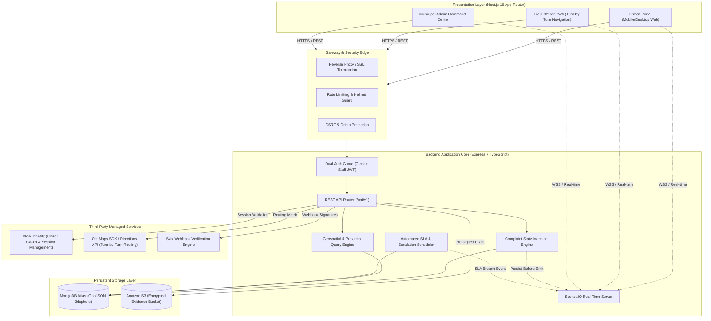
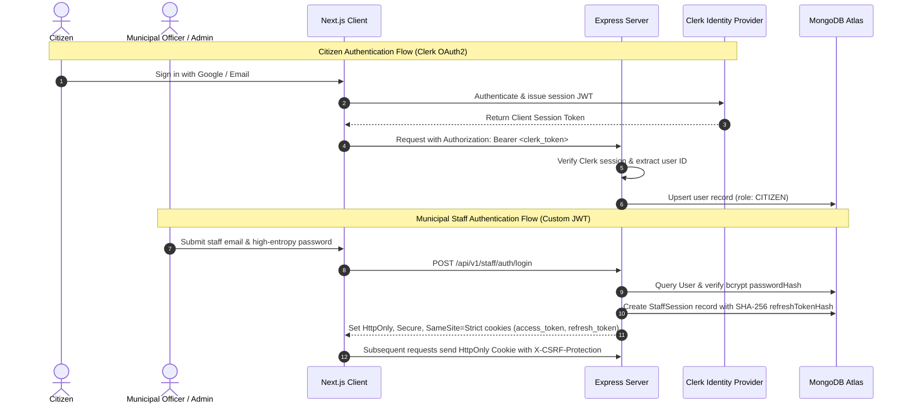
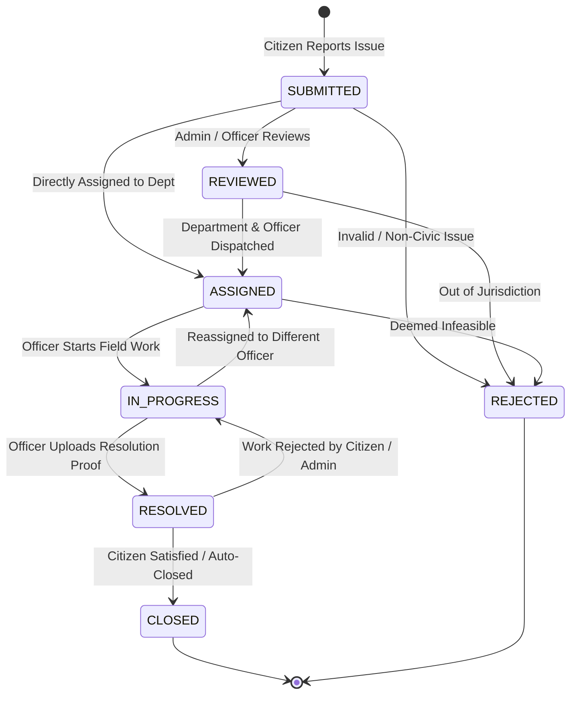
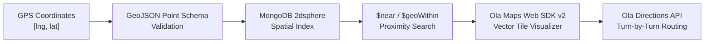
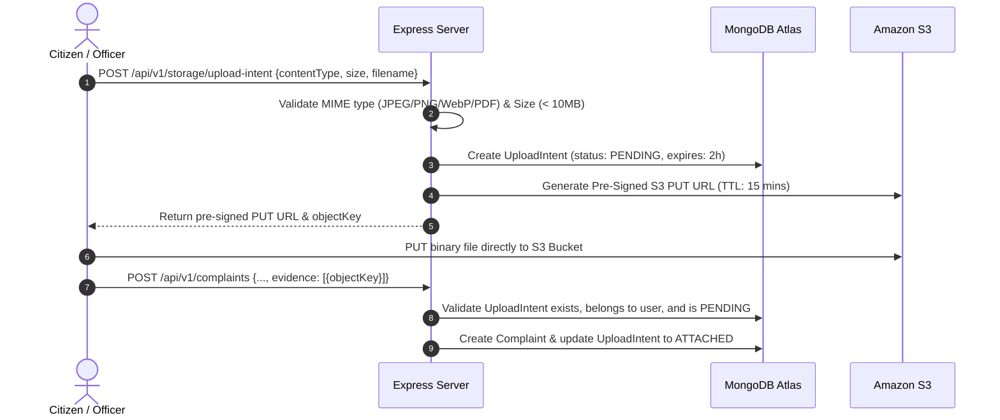

# CivicTrack System Architecture Specification

CivicTrack is an enterprise-grade municipal civic complaint management and automated resolution system engineered with a high-throughput **Node.js 24/Express** backend, a **Next.js 16 (App Router)** client application, **MongoDB Atlas** with spatial indexing, **Socket.IO** real-time event streaming, and **AWS S3** pre-signed object storage.

---

## 1. High-Level System Architecture



---

## 2. Monorepo Architecture

CivicTrack is organized as an **npm workspaces monorepo** to maximize code reuse, establish strict compile-time boundaries, and guarantee type safety across frontend and backend tiers:

```text
CivicTrack/
├── packages/
│   ├── contracts/        # Shared Zod schemas, lifecycle enums, DTOs & event types
│   └── config/           # Standardized ESLint, Prettier, and TypeScript configurations
├── apps/
│   ├── server/           # Express REST API, Mongoose models, and Socket.IO server
│   └── web/              # Next.js 16 App Router frontend with Tailwind & MapLibre GL
└── docs/                 # Architectural specifications, ERD, and deployment guides
```

### Shared Contracts (`@civictrack/contracts`)
Both `apps/server` and `apps/web` import strict Zod schemas and TypeScript interfaces from `@civictrack/contracts`. This guarantees:
* Zero discrepancy between client form validation and backend input parsing.
* Single source of truth for the complaint state machine (`isValidStatusTransition`).
* Typed Socket.IO event payloads across WebSocket boundaries.

---

## 3. Dual Identity & Authentication Architecture

CivicTrack implements a **hybrid identity architecture** tailored to user roles:



---

## 4. Real-Time Event Architecture (Socket.IO)

CivicTrack uses **Socket.IO** with a strict **Persist-Before-Emit** pattern and isolated room taxonomies:

### 4.1 Room Taxonomy
* `user:{userId}`: Direct personal notifications (e.g. status changes on reported complaints).
* `role:{citizen|officer|admin}`: Role-wide broadcasts (e.g. administrative announcements).
* `department:{departmentId}`: Scoped dispatches (e.g. new complaint assigned to Roads & Bridges).
* `complaint:{complaintId}`: Targeted audit tracking (e.g. comments, live field updates).

### 4.2 Dual-Handshake Authentication
1. **Citizens:** Authenticated during handshake via Clerk bearer token verified through `@clerk/express`.
2. **Staff:** Authenticated via HttpOnly staff session cookie or handshake query token verified against `STAFF_JWT_ACCESS_SECRET`.

### 4.3 Resilience & Reconnection Recovery
* **Sliding-Window Event Deduplication:** Client-side event IDs are tracked in a 30-second TTL cache to eliminate duplicate UI renders during network flaps.
* **Stale-State Reconciliation:** Upon WebSocket reconnect, the client automatically triggers background REST synchronization to fetch changes that occurred during downtime.

---

## 5. Complaint Lifecycle State Machine

Complaints strictly progress according to the validated municipal lifecycle:



---

## 6. Geospatial Engine & Turn-by-Turn Navigation



1. **GeoJSON Standard:** Coordinates are strictly stored as `[longitude, latitude]` following WGS 84 conventions.
2. **Spatial Deduplication:** When a complaint is filed, the backend searches within a 50m radius for complaints with matching categories to prevent duplicate reports.
3. **Field Navigation:** Officers receive turn-by-turn routing directly inside the progressive web app via Ola Maps Directions API.

---

## 7. Secure S3 Pre-Signed Upload Intent Flow

CivicTrack avoids routing multi-megabyte media uploads through the API server, eliminating bandwidth bottlenecks:



---

## 8. Automated SLA Escalation Engine

* **Deterministic Deadlines:** Based on priority (`CRITICAL`: 12h, `HIGH`: 24h, `MEDIUM`: 48h, `LOW`: 72h).
* **Automated Cron Scanner:** A background worker runs every 15 minutes checking for `status !== 'RESOLVED'` and `dueAt < now`.
* **Escalation Hierarchy:** Creates an `SlaEscalation` audit record, triggers emergency administrative notifications, and dispatches real-time alerts across `role:admin` and department rooms.
