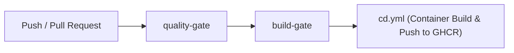

# CivicTrack — CI/CD Pipeline & Containerization

> Matches [`ci.yml`](../.github/workflows/ci.yml), [`cd.yml`](../.github/workflows/cd.yml), [`docker-compose.yml`](../docker-compose.yml), [`apps/server/Dockerfile`](../apps/server/Dockerfile), and [`apps/web/Dockerfile`](../apps/web/Dockerfile).

**Related Docs:** [README](../README.md) • [Architecture](ARCHITECTURE.md) • [Database Structure](DATABASE_STRUCTURE.md) • [API Documentation](API_DOCUMENTATION.md) • [Features](FEATURES.md) • [Tech Stack](TECH_STACK.md) • [Quickstart](QUICKSTART.md)

---

## 1. Continuous Integration (`.github/workflows/ci.yml`)

The CI workflow defines two verification jobs: `quality-gate` and `build-gate`.



### 1.1 `quality-gate`
1. Installs monorepo dependencies in CI.
2. Builds shared contracts first:
   ```bash
   npm run build --workspace=@civictrack/contracts
   ```
3. Runs `npm run typecheck`.
4. Runs `npm run lint` (`@civictrack/web` runs `tsc --noEmit`; `@civictrack/config` is a no-op stub exiting `0`; there is no ESLint or Prettier config).
5. Runs `npm test`:
   - **`@civictrack/server`:** Executes **15** deterministic test suites via `tsx`:
     `tests/server.test.ts`, `auth.test.ts`, `staff-auth.test.ts`, `admin-register.test.ts`, `complaints.test.ts`, `storage.test.ts`, `maps.test.ts`, `notifications.test.ts`, `analytics-sla.test.ts`, `security-hardening.test.ts`, `socket-auth.test.ts`, `authorization-privacy.test.ts`, `officers-management.test.ts`, `admin-scoped-data.test.ts`, and `clerk-jit-concurrency.test.ts`.
   - **`@civictrack/contracts`:** Exits `0` (`"Contracts validated via tsc"`).
   - **`@civictrack/web`:** Exits `0` (`"No frontend tests in Phase 1"`).

### 1.2 `build-gate`
Validates production compilation of contracts, server, and Next.js frontend with explicit CI environment variables:
- `NEXT_TELEMETRY_DISABLED=1`
- `NODE_ENV=production`
- `NEXT_PUBLIC_API_URL=http://localhost:10000/api/v1`
- `INTERNAL_API_URL=http://localhost:10000`

---

## 2. Continuous Delivery (`.github/workflows/cd.yml`)

The CD workflow builds container images from the workspace Dockerfiles and publishes them to GitHub Container Registry (GHCR):

| Image | Dockerfile | Target Registry Path |
| :--- | :--- | :--- |
| Backend API & Socket.IO Server | [`apps/server/Dockerfile`](../apps/server/Dockerfile) | `ghcr.io/${{ github.repository }}/server` |
| Next.js Frontend Application | [`apps/web/Dockerfile`](../apps/web/Dockerfile) | `ghcr.io/${{ github.repository }}/web` |

- **API URL Configuration:** `cd.yml` resolves `PRODUCTION_API_URL` from either GitHub Actions repository/environment variables or secrets:
  `${{ vars['PRODUCTION_API_URL'] || secrets['PRODUCTION_API_URL'] }}`.

---

## 3. Local Container Orchestration (`docker-compose.yml`)

[`docker-compose.yml`](../docker-compose.yml) defines three services for local container execution:

| Service | Image / Build Context | Host Port | Key Environment Notes |
| :--- | :--- | :--- | :--- |
| `mongodb` | `mongo:7-jammy` | `27017` | Persistent MongoDB volume for local state |
| `server` | `./apps/server/Dockerfile` | `4000` | Connects to `mongodb` and serves REST + Socket.IO |
| `web` | `./apps/web/Dockerfile` | `3000` | Configures `INTERNAL_API_URL=http://server:4000` for Next.js API/docs rewrites |

> **Configuration Note:** `docker-compose.yml` does not pass Clerk credentials (`NEXT_PUBLIC_CLERK_PUBLISHABLE_KEY`, `CLERK_SECRET_KEY`) into the `web` service by default. Provide them if testing Clerk citizen authentication inside Docker Compose.
