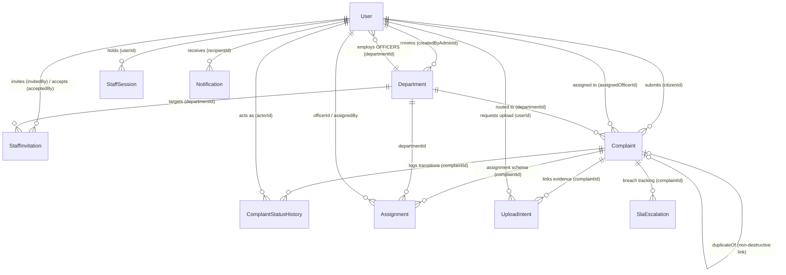

# CivicTrack — Database Structure & Schema Reference

> Persistence layer documentation aligned with Mongoose models in [`apps/server/src/modules/`](../apps/server/src/modules) and shared contracts in [`packages/contracts/src/`](../packages/contracts/src).

**Related Docs:** [README](../README.md) • [Architecture](ARCHITECTURE.md) • [API Documentation](API_DOCUMENTATION.md) • [Features](FEATURES.md) • [Tech Stack](TECH_STACK.md) • [Quickstart](QUICKSTART.md) • [CI/CD Pipeline](CI_CD_PIPELINE.md)

---

## 1. Overview

CivicTrack persists application state in **MongoDB** (MongoDB Atlas in production; `mongo:7-jammy` in Docker Compose for local development) via **Mongoose `^8.10.1`**. Connection URI configuration uses `ATLAS_URI` (see [Quickstart](QUICKSTART.md#3-environment-variables)).

### Core Collections / Models (11)

| Model | Module Path | Purpose |
| :--- | :--- | :--- |
| `User` | `apps/server/src/modules/users/user.model.ts` | Citizens (Clerk-backed), Officers, and Administrators |
| `Department` | `apps/server/src/modules/departments/department.model.ts` | Creator-scoped municipal departments and handled categories |
| `Complaint` | `apps/server/src/modules/complaints/complaint.model.ts` | Core civic grievance records with GeoJSON Point & evidence |
| `ComplaintStatusHistory` | `apps/server/src/modules/complaints/complaint-history.model.ts` | Append-only status transition audit log |
| `Assignment` | `apps/server/src/modules/complaints/assignment.model.ts` | Assignment history schema (defined in codebase; see note below) |
| `Counter` | `apps/server/src/modules/complaints/counter.model.ts` | Atomic yearly sequence counter for `CT-YYYY-NNNNNN` IDs |
| `StaffSession` | `apps/server/src/modules/staff-auth/staff-session.model.ts` | Hashed staff refresh-token sessions with MongoDB TTL expiration |
| `StaffInvitation` | `apps/server/src/modules/staff-auth/staff-invitation.model.ts` | Invite tokens for onboarding Officers (and staff registration checks) |
| `UploadIntent` | `apps/server/src/modules/storage/upload-intent.model.ts` | Pre-signed S3 upload tracking (`PENDING`, `ATTACHED`, `EXPIRED`) |
| `SlaEscalation` | `apps/server/src/modules/sla/sla-escalation.model.ts` | Idempotent SLA breach records (`{ complaintId, dueAt }` unique) |
| `Notification` | `apps/server/src/modules/notifications/notification.model.ts` | In-app notifications per recipient |

---

## 2. Entity-Relationship Diagram



> **Note:** `Counter` operates independently using string `_id` keys (e.g., `complaint_seq_2026`) to mint monotonic complaint reference numbers (`CT-YYYY-NNNNNN`).

---

## 3. Collection & Schema Details

All schema options disable Mongoose `__v` (`versionKey: false`) on the core domain models documented below.

### 3.1 `User` (`user.model.ts`)

Represents citizens provisioned through Clerk (`clerkUserId`) as well as password-authenticated staff accounts (`ADMIN` and `OFFICER`).

| Field | Type / Constraints | Index |
| :--- | :--- | :--- |
| `clerkUserId` | `String`, unique, sparse | Yes |
| `email` | `String`, unique, lowercase | Yes |
| `passwordHash` | `String`, `select: false` | — |
| `name` | `String`, max length `120` | — |
| `role` | Enum: `CITIZEN` \| `OFFICER` \| `ADMIN` | Yes |
| `departmentId` | `ObjectId` ref `Department` | Yes |
| `isActive` | `Boolean`, default `true` | Yes |
| `createdAt`, `updatedAt` | Mongoose timestamps | — |

**Compound Indexes:**
- `{ role: 1, isActive: 1 }`
- `{ departmentId: 1, role: 1 }`

---

### 3.2 `Department` (`department.model.ts`)

Municipal service departments scoped by the creating administrator (`createdByAdminId`) for tenant/administrator isolation.

| Field | Type / Constraints | Index |
| :--- | :--- | :--- |
| `name` | `String`, max length `120` | — |
| `code` | `String`, unique, uppercase, max length `20` | Unique |
| `categories` | Array of `ComplaintCategory` enum values | — |
| `createdByAdminId` | `ObjectId` ref `User` | Yes |
| `isActive` | `Boolean` | Yes |
| `createdAt`, `updatedAt` | Mongoose timestamps | — |

**Compound Index:**
- `{ createdByAdminId: 1, isActive: 1 }`

---

### 3.3 `Complaint` (`complaint.model.ts`)

Stores civic grievance submissions, geospatial coordinates (`[lng, lat]`), assignment metadata, SLA deadline (`dueAt`), resolution details, and citizen feedback.

| Field | Type / Constraints | Index |
| :--- | :--- | :--- |
| `referenceNumber` | `String`, unique (format `CT-YYYY-NNNNNN`) | Unique |
| `citizenId` | `ObjectId` ref `User` | Yes |
| `title` | `String`, length `5`–`150` | — |
| `description` | `String`, length `20`–`2000` | — |
| `category` | Enum (`ComplaintCategory`) | Yes |
| `status` | Enum (`ComplaintStatus`) | Yes |
| `priority` | Enum (`LOW` \| `MEDIUM` \| `HIGH` \| `CRITICAL`) | Yes |
| `location` | GeoJSON `Point` (`coordinates: [lng, lat]`) | `2dsphere` |
| `address` | `String`, max length `300` | — |
| `landmark` | `String`, max length `150` | — |
| `evidence` | `EvidenceItem[]` (object keys & metadata; view URLs generated on read) | — |
| `departmentId` | `ObjectId` ref `Department` | Yes |
| `assignedOfficerId` | `ObjectId` ref `User` | Yes |
| `dueAt` | `Date` (computed SLA deadline) | — |
| `resolvedAt` | `Date` | — |
| `closedAt` | `Date` | — |
| `rejectionReason` | `String`, max length `500` | — |
| `resolutionRemarks` | `String`, max length `1000` | — |
| `resolutionEvidence` | `EvidenceItem[]` | — |
| `feedbackRating` | `Number`, range `1`–`5` | — |
| `feedbackComment` | `String`, max length `1000` | — |
| `feedbackSubmittedAt` | `Date` | — |
| `duplicateOf` | `ObjectId` ref `Complaint` | Yes |
| `isDuplicate` | `Boolean`, default `false` | Yes |
| `createdAt`, `updatedAt` | Mongoose timestamps | — |

**Geospatial & Compound Indexes:**
- `{ location: "2dsphere" }`
- `{ citizenId: 1, createdAt: -1 }`
- `{ status: 1, createdAt: -1 }`
- `{ departmentId: 1, status: 1, priority: 1 }`
- `{ departmentId: 1, createdAt: -1 }`
- `{ assignedOfficerId: 1, status: 1 }`

---

### 3.4 `ComplaintStatusHistory` (`complaint-history.model.ts`)

Immutable audit trail recording workflow status transitions, acting user, remarks, and supporting evidence.

| Field | Type / Constraints | Index |
| :--- | :--- | :--- |
| `complaintId` | `ObjectId` ref `Complaint` | Yes |
| `fromStatus` | `ComplaintStatus` | — |
| `toStatus` | `ComplaintStatus` | — |
| `actorId` | `ObjectId` ref `User` | Yes |
| `remarks` | `String`, max length `1000` | — |
| `evidence` | `EvidenceItem[]` | — |
| `createdAt` | `Date` | Yes |

**Compound Index:**
- `{ complaintId: 1, createdAt: 1 }`

---

### 3.5 `Assignment` (`assignment.model.ts`)

| Field | Type / Constraints | Index |
| :--- | :--- | :--- |
| `complaintId` | `ObjectId` ref `Complaint` | Yes |
| `departmentId` | `ObjectId` ref `Department` | Yes |
| `officerId` | `ObjectId` ref `User` | Yes |
| `assignedBy` | `ObjectId` ref `User` | — |
| `remarks` | `String`, max length `500` | — |
| `assignedAt` | `Date` | Yes |
| `unassignedAt` | `Date` | — |

**Compound Index:**
- `{ complaintId: 1, assignedAt: -1 }`

> **Implementation Note:** The `Assignment` Mongoose model and indexes are defined in `apps/server/src/modules/complaints/assignment.model.ts`, but current workflow services (`complaint-workflow.service.ts`) record assignment state directly on `Complaint` (`departmentId`, `assignedOfficerId`) and write audit entries to `ComplaintStatusHistory` without importing `Assignment`.

---

### 3.6 `Counter` (`counter.model.ts`)

| Field | Type / Constraints | Index |
| :--- | :--- | :--- |
| `_id` | `String` (e.g., `complaint_seq_2026`) | Primary `_id` |
| `seq` | `Number` | — |

Generates sequential `CT-YYYY-NNNNNN` complaint reference numbers using atomic increments, with a random 6-digit fallback if MongoDB is disconnected.

---

### 3.7 `StaffSession` (`staff-session.model.ts`)

Tracks hashed refresh tokens for `ADMIN` and `OFFICER` cookie-based sessions.

| Field | Type / Constraints | Index |
| :--- | :--- | :--- |
| `userId` | `ObjectId` ref `User` | Yes |
| `role` | Staff role (`ADMIN` \| `OFFICER`) | — |
| `refreshTokenHash` | `String` (not marked `unique` in Mongoose schema) | Yes |
| `userAgent` | `String` | — |
| `ipAddress` | `String` | — |
| `expiresAt` | `Date` | **TTL Index** (`{ expires: 0 }`) |
| `isRevoked` | `Boolean` | Yes |
| `revokedAt` | `Date` | — |
| `createdAt`, `updatedAt` | Mongoose timestamps | — |

**Compound Index:**
- `{ userId: 1, isRevoked: 1 }`

---

### 3.8 `StaffInvitation` (`staff-invitation.model.ts`)

Stores cryptographic hashes of single-use staff onboarding invitations.

| Field | Type / Constraints | Index |
| :--- | :--- | :--- |
| `email` | `String` (not marked `unique`) | Yes |
| `role` | Staff role | Yes |
| `departmentId` | `ObjectId` ref `Department` | Yes |
| `tokenHash` | `String`, unique | Unique |
| `status` | Enum: `PENDING` \| `ACCEPTED` \| `REVOKED` \| `EXPIRED` | Yes |
| `invitedBy` | `ObjectId` ref `User` | — |
| `expiresAt` | `Date` (**standard index, no MongoDB TTL auto-deletion**) | Yes |
| `acceptedAt` | `Date` | — |
| `acceptedBy` | `ObjectId` ref `User` | — |
| `revokedAt` | `Date` | — |
| `revokedBy` | `ObjectId` ref `User` | — |
| `createdAt`, `updatedAt` | Mongoose timestamps | — |

**Compound Indexes:**
- `{ email: 1, status: 1 }`
- `{ tokenHash: 1, status: 1 }`

---

### 3.9 `UploadIntent` (`upload-intent.model.ts`)

Tracks S3 pre-signed PUT upload intents before and after attachment to a complaint or resolution.

| Field | Type / Constraints | Index |
| :--- | :--- | :--- |
| `objectKey` | `String`, unique | Unique |
| `userId` | `ObjectId` ref `User` | Yes |
| `contentType` | `String` (`image/jpeg`, `image/png`, `image/webp`) | — |
| `size` | `Number` | — |
| `checksum` | `String` | — |
| `status` | Enum: `PENDING` \| `ATTACHED` \| `EXPIRED` | Yes |
| `complaintId` | `ObjectId` ref `Complaint` | Yes |
| `expiresAt` | `Date`, required (**no MongoDB TTL auto-deletion**; stale records are handled via `POST /api/v1/storage/cleanup`) | — |
| `createdAt`, `updatedAt` | Mongoose timestamps | — |

**Compound Index:**
- `{ status: 1, createdAt: 1 }`

---

### 3.10 `SlaEscalation` (`sla-escalation.model.ts`)

Records SLA deadline breaches discovered by the periodic background scanner or manual admin scan.

| Field | Type / Constraints | Index |
| :--- | :--- | :--- |
| `complaintId` | `ObjectId` ref `Complaint` | Yes |
| `dueAt` | `Date` | — |
| `escalatedAt` | `Date` | — |
| `delayHours` | `Number` | — |
| `isResolved` | `Boolean` | Yes |
| `resolvedAt` | `Date` | — |
| `notifiedAdminsCount` | `Number` | — |
| `createdAt`, `updatedAt` | Mongoose timestamps | — |

**Unique Compound Index:**
- `{ complaintId: 1, dueAt: 1 }` — guarantees each breach per `(complaintId, dueAt)` window is escalated at most once.

---

### 3.11 `Notification` (`notification.model.ts`)

Persists real-time user notifications triggered by complaint lifecycle transitions, assignments, and SLA breaches.

| Field | Type / Constraints | Index |
| :--- | :--- | :--- |
| `recipientId` | `ObjectId` ref `User` | Yes |
| `type` | Notification type (e.g., `SLA_BREACH`, status/assignment types) | — |
| `title` | `String`, max length `200` | — |
| `message` | `String`, max length `1000` | — |
| `resourceType` | Enum: `COMPLAINT` \| `ASSIGNMENT` \| `SYSTEM` | — |
| `resourceId` | `ObjectId` / `String` | — |
| `readAt` | `Date` | — |
| `createdAt`, `updatedAt` | Mongoose timestamps | — |

**Compound Index:**
- `{ recipientId: 1, readAt: 1, createdAt: -1 }`

---

## 4. Shared Domain Enums (`packages/contracts/src/enums.ts`)

- **`ComplaintStatus`:** `SUBMITTED`, `UNDER_REVIEW`, `VERIFIED`, `REJECTED`, `ASSIGNED`, `IN_PROGRESS`, `RESOLVED`, `CLOSED`
- **`ComplaintCategory`:** `ROADS_POTHOLES`, `WATER_SUPPLY`, `GARBAGE_SANITATION`, `DRAINAGE_SEWAGE`, `STREETLIGHTS`, `ELECTRICITY`, `GENERAL`
- **`ComplaintPriority`:** `LOW`, `MEDIUM`, `HIGH`, `CRITICAL`
- **`UserRole`:** `CITIZEN`, `OFFICER`, `ADMIN`

---

## 5. Index Synchronization & Operational Scripts

- **Sync Mongoose Indexes:**
  ```bash
  npm run sync:indexes --workspace=@civictrack/server
  ```
  Executes `apps/server/src/scripts/sync-indexes.ts` to align MongoDB collection indexes with Mongoose schema definitions.
- **Database Seeding & Bootstrap Scripts** (in `apps/server/src/scripts/`):
  - `npm run seed:staff --workspace=@civictrack/server` (`seed-staff.ts`): Seeds sample departments (`TRANS` and `SWM`) and initial staff users (supports `INITIAL_ADMIN_EMAIL`, `INITIAL_ADMIN_PASSWORD`, `INITIAL_OFFICER_EMAIL`, `INITIAL_OFFICER_PASSWORD`).
  - `create-invite.ts` (`npm run invite --workspace=@civictrack/server`): CLI helper for generating a staff invitation.
  - `bootstrap-admin.ts` & `backfill-department-creators.ts`: Standalone operational TypeScript scripts in `apps/server/src/scripts/`.
