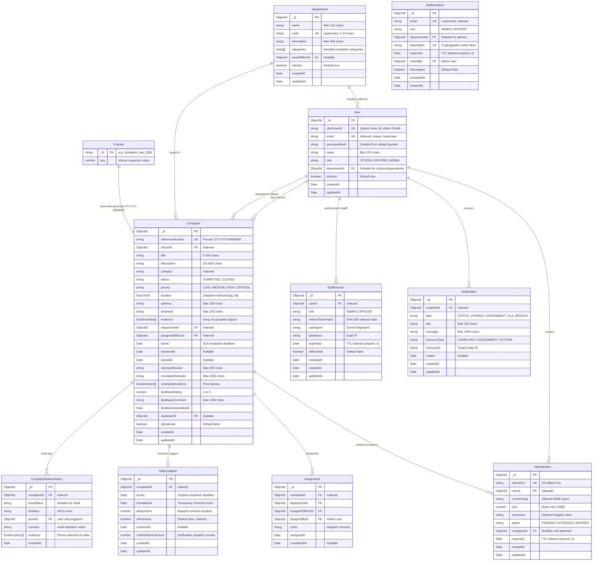

# CivicTrack Database Architecture & Schema Specification

CivicTrack utilizes **MongoDB Atlas** as its primary persistent operational datastore, engineered through **Mongoose** with strict TypeScript schemas, atomic sequence counters, compound querying indexes, TTL auto-expirations, and a dedicated GeoJSON `2dsphere` spatial indexing engine.

---

## 1. High-Level Entity-Relationship Diagram (ERD)



---

## 2. Detailed Collection Specifications

### 2.1 `complaints` Collection
The core operational document representing a civic issue reported by a citizen.

* **Primary Key:** `_id` (ObjectId)
* **Spatial System:** GeoJSON Point `[longitude, latitude]` obeying WGS 84 conventions.
* **Indexes:**
  ```javascript
  // 1. Geospatial 2dsphere index for proximity lookup & duplicate detection
  { location: "2dsphere" }

  // 2. Citizen complaint history timeline (descending)
  { citizenId: 1, createdAt: -1 }

  // 3. Workflow stage and global dashboard ordering
  { status: 1, createdAt: -1 }

  // 4. Department routing and prioritization
  { departmentId: 1, status: 1, priority: 1 }

  // 5. Field officer task workload
  { assignedOfficerId: 1, status: 1 }

  // 6. Unique reference number lookup
  { referenceNumber: 1 }, { unique: true }
  ```

---

### 2.2 `users` Collection
Manages identities for both public citizens (authenticated via Clerk OAuth) and municipal municipal employees (officers, supervisors, admins).

* **Indexes:**
  ```javascript
  // Unique email index
  { email: 1 }, { unique: true }

  // Sparse index for external Clerk identity
  { clerkUserId: 1 }, { unique: true, sparse: true }

  // Role & Department assignment filter
  { role: 1, departmentId: 1 }
  ```

---

### 2.3 `upload_intents` Collection
Enforces **Pre-Signed Upload Security**. No evidence photo can be attached to a complaint unless a pre-signed intent was generated, verified for MIME type and file size, and attached before expiration.

* **TTL Expiration:** Automatically garbage-collected if unused within 2 hours.
* **Indexes:**
  ```javascript
  { objectKey: 1 }, { unique: true }
  { userId: 1, status: 1 }
  { expiresAt: 1 }, { expireAfterSeconds: 0 } // MongoDB TTL Index
  ```

---

### 2.4 `staff_sessions` Collection
Manages long-lived refresh tokens and active hardware sessions for municipal officers and administrators.

* **Security:** Refresh tokens are never stored plaintext; they are hashed with SHA-256 before insertion.
* **TTL Expiration:** Automatically purged upon session expiration.
* **Indexes:**
  ```javascript
  { refreshTokenHash: 1 }, { unique: true }
  { userId: 1, isRevoked: 1 }
  { expiresAt: 1 }, { expireAfterSeconds: 0 } // MongoDB TTL Index
  ```

---

### 2.5 `sla_escalations` Collection
Tracks automated SLA breach records identified by the background cron worker.

* **Indexes:**
  ```javascript
  { complaintId: 1 }
  { isResolved: 1, delayHours: -1 }
  ```

---

### 2.6 `counters` Collection
Provides **Atomic Reference Number Generation** via MongoDB's native `$inc` and `findOneAndUpdate(..., { upsert: true })`.

* **Document Structure:**
  ```json
  {
    "_id": "complaint_seq_2026",
    "seq": 1042
  }
  ```
* **Format Generated:** `CT-YYYY-NNNNNN` (e.g., `CT-2026-001042`).

---

## 3. Data Integrity & Concurrency Controls

1. **Atomic Lifecycle Transitions:** State updates are validated against `isValidStatusTransition()` in `@civictrack/contracts` before executing atomic Mongoose operations.
2. **Persist-Before-Emit Pattern:** In real-time events, the MongoDB transaction or update is committed **before** emitting events across Socket.IO rooms. If the write fails, no ghost events are dispatched.
3. **Optimistic Locking & Duplicate Suppression:** Spatial queries leverage spherical distance calculations (`$maxDistance` in meters) paired with category matching to prevent accidental double-reporting within a 50-meter radius.
