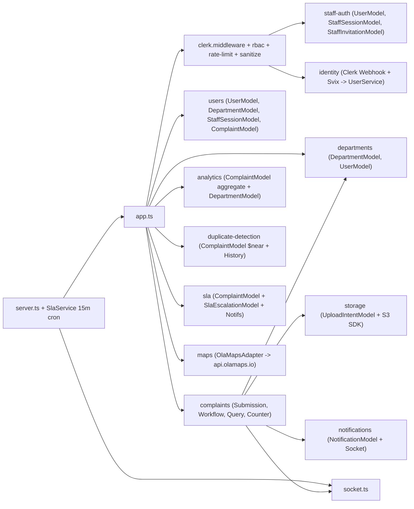

# CivicTrack Phase 0 — Dependency Graph & Runtime Architecture

## 1. Monorepo Package Dependencies (Locked Versions from `package-lock.json`)

| Workspace | Direct Runtime Dependencies | Direct Dev Dependencies | Workspace Edges |
| :--- | :--- | :--- | :--- |
| Root (`package.json`) | None | None | Orchestrates `apps/*`, `packages/*` via npm workspaces |
| `@civictrack/config` | None | None | Stub config package (`exit 0` scripts) |
| `@civictrack/contracts` | `zod` (`^3.24.2` -> `3.25.76`) | `rimraf` (`^6.0.1` -> `6.1.4`), `typescript` (`^5.7.3` -> `5.9.3`) | Imported by `@civictrack/server` and `@civictrack/web` |
| `@civictrack/server` | `@aws-sdk/client-s3` (`3.1175.0`), `@aws-sdk/lib-storage` (`3.1175.0`), `@aws-sdk/s3-request-presigner` (`3.1175.0`), `@clerk/express` (`2.1.96`), `bcryptjs` (`3.0.3`), `cookie-parser` (`1.4.7`), `cors` (`2.8.6`), `dotenv` (`16.6.1`), `express` (`4.22.3`), `express-rate-limit` (`8.7.5`), `helmet` (`8.3.0`), `jsonwebtoken` (`9.0.3`), `mongoose` (`8.24.10`), `multer` (`2.5.0`), `socket.io` (`4.8.4`), `svix` (`2.11.0`), `swagger-ui-express` (`5.0.1`), `zod` (`3.25.76`), **misplaced:** `@types/multer` (`2.3.0`), `@types/swagger-ui-express` (`4.1.8`) | `@types/bcryptjs` (`2.4.6`), `@types/cookie-parser` (`1.4.10`), `@types/cors` (`2.8.19`), `@types/express` (`4.17.25`), `@types/jsonwebtoken` (`9.0.10`), `@types/node` (`22.20.5`), `@types/supertest` (`7.2.1`), `rimraf` (`6.1.4`), `supertest` (`7.3.2`), `tsx` (`4.23.15`), `typescript` (`5.9.3`) | Depends on `@civictrack/contracts` |
| `@civictrack/web` | `@clerk/nextjs` (`7.10.7`), `@clerk/themes` (`2.4.57`), `clsx` (`2.1.1`), `lucide-react` (`0.475.0`), `maplibre-gl` (`5.12.0`), `next` (`16.4.6`), `olamaps-web-sdk` (`1.4.0`), `react` (`19.3.1`), `react-dom` (`19.3.1`), `socket.io-client` (`4.8.4`), `tailwind-merge` (`2.6.2`), `zod` (`3.25.76`) | `@types/node` (`22.20.5`), `@types/react` (`19.3.0`), `@types/react-dom` (`19.3.0`), `autoprefixer` (`10.7.0`), `postcss` (`8.5.33`), `tailwindcss` (`3.4.19`), `tailwindcss-animate` (`1.0.7`), `typescript` (`5.9.3`) | Depends on `@civictrack/contracts` |

---

## 2. Backend Module Dependency Graph

### Mongoose Collections Mapped to Producers
| Collection | Model | Indexes Defined in Code | Readers / Writers |
| :--- | :--- | :--- | :--- |
| `users` | `UserModel` | `clerkUserId` (unique sparse), `email` (unique), `role`, `departmentId`, `isActive`, `{role:1,isActive:1}`, `{departmentId:1,role:1}` | `user.service`, `clerk.middleware`, `staff-auth`, `socket`, `complaint-*`, `sla.service` |
| `departments` | `DepartmentModel` | `code` (unique), `createdByAdminId`, `isActive`, `{createdByAdminId:1,isActive:1}` | `department.service`, `user.service`, `complaint-query`, `analytics`, `staff-auth` |
| `complaints` | `ComplaintModel` | `referenceNumber` (unique), `citizenId`, `category`, `status`, `priority`, `departmentId`, `assignedOfficerId`, `duplicateOf`, `isDuplicate`, `location:"2dsphere"`, `{citizenId:1,createdAt:-1}`, `{status:1,createdAt:-1}`, `{departmentId:1,status:1,priority:1}`, `{assignedOfficerId:1,status:1}` | `complaint-*`, `analytics`, `duplicate-detection`, `sla`, `storage`, `socket`, `user.service` |
| `complaintstatushistories` | `ComplaintStatusHistoryModel` | `complaintId`, `actorId`, `createdAt`, `{complaintId:1,createdAt:1}` | `complaint-submission`, `complaint-workflow`, `complaint-query`, `duplicate-detection` |
| `counters` | `CounterModel` | `_id` primary | `complaint-submission` |
| `assignments` | `AssignmentModel` | `complaintId`, `departmentId`, `officerId`, `assignedAt`, `{complaintId:1,assignedAt:-1}` | **NONE (Dead model)** |
| `uploadintents` | `UploadIntentModel` | `objectKey` (unique), `userId`, `status`, `complaintId`, `{status:1,createdAt:1}` | `storage.service`, `s3.service`, `complaint.controller` |
| `staffsessions` | `StaffSessionModel` | `userId`, `role`, `refreshTokenHash`, `expiresAt` (`expires:0` TTL), `isRevoked`, `{userId:1,isRevoked:1}` | `staff-auth.service`, `clerk.middleware`, `user.service` |
| `staffinvitations` | `StaffInvitationModel` | `email`, `role`, `departmentId`, `tokenHash` (unique), `status`, `expiresAt`, `{email:1,status:1}`, `{tokenHash:1,status:1}` | `staff-auth.service`, `user.service` |
| `notifications` | `NotificationModel` | `recipientId`, `{recipientId:1,readAt:1,createdAt:-1}` | `notification.service` |
| `slaescalations` | `SlaEscalationModel` | `complaintId`, `isResolved`, `{complaintId:1,dueAt:1}` (unique) | `sla.service` |

---

## 3. Frontend Component, Hook & Proxy Topology

- **HTTP Proxy:** `apps/web/next.config.mjs` rewrites `/api/v1/:path*` and `/docs/:path*` to `NEXT_PUBLIC_API_URL` (default `http://127.0.0.1:4000/api/v1/:path*`).
  - Exception bypassing proxy: `apps/web/src/app/map/page.tsx:161` calls `${process.env.NEXT_PUBLIC_API_URL || "http://127.0.0.1:4000/api/v1"}/complaints/nearby` directly.
- **Rendering Boundary Split:**
  - Server Components (`5` files): `app/layout.tsx`, `app/page.tsx` (**forces dynamic SSR via `await auth()`**), `app/not-found.tsx`, `app/(auth)/sign-in/[[...sign-in]]/page.tsx`, `app/(auth)/sign-up/[[...sign-up]]/page.tsx`.
  - Client Components (`22` app files + `20` UI/map components + `1` context + `8` hooks): All `/citizen/**`, `/officer/**`, `/admin/**`, `/map`, and `/notifications` pages/layouts use `"use client"`.
- **Map SDK Loading:**
  - `app/globals.css:1` globally imports `maplibre-gl/dist/maplibre-gl.css` on **every route** including `/`, `/sign-in`, `/admin/officers`, `/admin/departments`.
  - `LocationPicker` (`apps/web/src/app/map/page.tsx:13`) and `OfficerNavigation` (`apps/web/src/app/officer/complaints/[id]/page.tsx:10`) are statically imported, while `SpatialMapPreview` and `OlaMap` elsewhere use `next/dynamic(..., { ssr: false })`.
- **Socket.IO Real-Time Connections:**
  - **Producers (Server `socket.ts`):**
    - `complaint:created` (`socket.ts:421`) -> `user:{citizenId}`, `role:admin`, `dept:{departmentId}`, `complaint:{id}`
    - `complaint:status-updated` (`socket.ts:446`) -> `user:{citizenId}`, `role:admin`, `dept:{departmentId}`, `user:{officerId}`, `complaint:{id}`
    - `complaint:assigned` (`socket.ts:472`) -> `dept:{departmentId}`, `role:admin`, `user:{officerId}`, `user:{citizenId}`, `complaint:{id}`
    - `notification:new` (`socket.ts:404`) -> `user:{recipientId}`
    - `dashboard:stats-updated` (`socket.ts:496`) -> `role:admin` | `dept:{departmentId}` | `user:{userId}`
  - **Consumers (Web `hooks/use-socket.ts`):**
    - `useNotifications` (inside `CitizenShell`, `OfficerShell`, `AdminShell` via `NotificationBell`, **plus duplicated** in `app/notifications/page.tsx`) -> opens independent Socket.IO connections!
    - `useRealtimeComplaints` (mounted on `/citizen`, `/citizen/complaints`, `/officer`, `/admin`) -> opens a second concurrent Socket.IO connection!
    - `useComplaintDetailRealtime` (mounted on `[id]` pages) -> emits `join` / `leave` for `complaint:{id}` -> opens another concurrent Socket.IO connection alongside `NotificationBell`'s socket!

---

## 4. Dead & Unreferenced Code Inventory

| Area | File / Symbol | Observation |
| :--- | :--- | :--- |
| Frontend Component | `apps/web/src/components/layout/persona-pills.tsx` | Zero imports across repo |
| Frontend Maps V2 (unfinished migration) | `components/maps/navigation/{navigation-panel,officer-navigation-view,route-layer}.tsx`, `hooks/use-navigation.ts`, `lib/navigation-service.ts` | Zero route imports (`officer/complaints/[id]/page.tsx` uses legacy `components/maps/officer-navigation.tsx`) |
| Frontend Helper | `apps/web/src/lib/utils.ts` (`cn`) | Zero imports across repo |
| Backend Model | `apps/server/src/modules/complaints/assignment.model.ts` (`AssignmentModel`) | Zero imports across repo |
| Backend Middleware | `apps/server/src/modules/identity/rbac.middleware.ts:31-54` (`requireDepartmentAccess`) | Zero callers |
| Backend Service Methods | `DepartmentService.seedDefaults`, `SlaService.calculateDueDate` | Zero callers (`UserService.bootstrapAdmin` is called by `scripts/bootstrap-admin.ts:24`) |
| Unused Imports | `PageHeader` in `app/citizen/complaints/[id]/page.tsx:16` | Imported cleanly without JSX usage |
